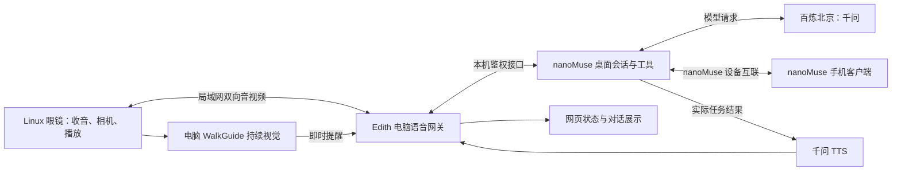

# Edith 接入 nanoMuse

## 目标与边界

眼镜使用现有 Pico Zero Linux、麦克风、喇叭和 IMX415。电脑运行 WalkGuide、语音网关和经过少量修改的 nanoMuse 桌面端。手机沿用 nanoMuse 官方客户端及其设备互联能力，不另写手机控制程序。

当前第一轮按用户最新要求先完成电脑：说“嗨，Edith”，再说“看看电脑屏幕，读出记事本内容”或“打开记事本”。电脑端 nanoMuse 使用千问理解指令，通过自己的电脑工具取屏、启动应用和输入。手机的“打开 App、查看页面并朗读”留到下一轮，继续沿用原客户端，不重写手机控制。



唤醒、AEC、语音识别、8 秒退出和 WalkGuide 即时提醒继续在电脑网关运行。nanoMuse 模式不再调用旧的 Qwen Omni 对话逻辑，回答文字由 nanoMuse 产生，千问 TTS 只负责朗读。待唤醒音频不上传云端。明确要求查看眼前画面时，网关才将新鲜图像交给 nanoMuse；“手机页面”不会触发眼镜摄像头。

眼镜与电脑使用本地热点。nanoMuse 默认的设备互联仍经过它自己的 Cloud/Hub，不会因两台设备同处局域网而自动变成纯局域网服务；部署自己的 Relay 需要另外按上游自托管指南配置。使用自有百炼密钥也不会取消账号和 Hub。

## Windows 11 安装与构建

先完成 [完整部署指南](Windows11完整部署.md) 的第 2–5 节，再配置本节。开发机已验证 Node 24 和 pnpm 11.25.0。安装 Node 后在新 PowerShell 执行 `npm install --global pnpm@11.25.0`，用 `node --version`、`pnpm --version` 确认。

首次完整部署先从 [nanoMuse 1.0.9 官方 Release](https://github.com/nano-muse/nanoMuse/releases/tag/v1.0.9) 安装 Windows x64 桌面版，再执行下方构建及“已有 nanoMuse 安装”流程；该流程同样适用于刚安装的人。官方安装包含电脑控制运行组件。源码桌面仅构建成功，不代表这些运行组件已完整配置。

在 AIGlass 根目录运行：

```powershell
./scripts/setup-nanomuse.ps1
```

上面只构建。完整电脑操作使用下面的 `-InstalledApp` 方式启动；仅做源码桥接开发时才用 `./scripts/start-nanomuse.ps1` 打开独立开发桌面。

### 已有 nanoMuse 安装与账号

已有安装时，先用 `setup-nanomuse.ps1` 构建插件，再从原 nanoMuse 的菜单/托盘正常退出，然后运行（替换为你的实际安装目录，目录中应有 `nanomuse-desktop.exe`）：

```powershell
./scripts/install-nanomuse-bridge.ps1 -AppRoot 'C:\Apps\nanoMuse'
./scripts/start-nanomuse.ps1 -InstalledApp 'C:\Apps\nanoMuse'
```

安装脚本核对 1.0.9 插件版本及实际 Harness 依赖版本，将原插件备份到 `.local/nanomuse-backups` 后更新桌面插件。它不会改动账号凭据、聊天记录和设备绑定。已绑定的手机无需重新登录；本轮开发机已采用这个流程，登录和 Hub 状态保留。

**日常从上述启动脚本打开 nanoMuse**，它会带上眼镜接口所需环境变量。直接使用官方快捷方式启动不会启用该接口。官方更新可能覆盖插件；遇到版本变化先重新适配和验证，不能强行覆盖。回退时先退出 nanoMuse，将 `.local/nanomuse-install.json` 中所记备份目录下的 `dsh-nanomuse` 内容复制回原安装的 `resources/dsh/node_modules/dsh-nanomuse`，再正常启动。

需要已有代理时，给构建命令追加 `-Proxy http://127.0.0.1:代理端口`。下载会写入忽略的 `.tools/nanomuse`，不会把整个上游、依赖、模型或账号资料提交到 Git。也可以两条命令都指定相同的 `-Source` 路径。

构建固定为 nanoMuse `09850259cab00d27af83786f00faa09b5d8494bf`。接入脚本校验版本和源码锚点，遇到不认识的本地修改会停止，不覆盖用户修改。它只增加本机接口、将接口接入现有 TaskRunner，以及按需接收眼镜图像。升级上游需要重新审查、编译和测试，不能直接把固定版本改成 main。

启动脚本生成 `.local/nanomuse-token`。默认源码运行使用独立配置目录 `.local/nanomuse-desktop`；`-InstalledApp` 使用原安装的配置和登录。不要把这些目录或令牌提交到 Git。没有发布自己的完整安装包。源码运行电脑鼠标键盘操作还需要上游 Hands runtime；已有官方安装携带的 runtime 可以继续使用，本机取屏和记事本操作已通过验证。

默认源码运行的浏览器缓存和单实例锁通过 `.local/nanomuse-browser` 隔离，允许与已有安装并存。`-InstalledApp` 不使用该隔离配置，而是复用用户已登录的桌面。不要同时启动两个眼镜接口占用同一端口。

## 账号与千问

1. 在打开的 nanoMuse 桌面窗口登录。仅使用电脑不要求绑定手机；需要手机控制时再安装 [nanoMuse 官方客户端](https://github.com/nano-muse/nanoMuse/releases)，登录同一账号并确认双方在线。
2. 在 nanoMuse 设置中添加自己的“阿里云百炼”密钥，地区选择中国内地，北京接口为 `https://dashscope.aliyuncs.com/compatible-mode/v1`。当前 AIGlass 的 `.env` 不会自动写入 nanoMuse 的凭据库。
3. **明确选择千问作为聊天模型和看图/操作模型。** 上游该版本的百炼默认聊天模型是 DeepSeek，不能只添加百炼提供商就认为已经选中了千问。可从账号可用列表选择支持工具调用、并具备图像输入的千问模型。本机密钥已查询到 `qwen3.5-plus`、`qwen3-vl-plus` 和 `qwen3.8-27b`；查询列表不等于完成每个模型的工具联调。
4. 手机自己的 nanoMuse 也需要选择千问。委派给手机的是任务，手机会使用它自己的模型设置，电脑的选择不会自动覆盖手机。
5. 先验证桌面端能使用电脑屏幕工具，再将 AIGlass `.env` 设为 `AI_BACKEND=nanomuse`，重新启动 Edith 后端。当前开发机已切换，并完成眼镜语音读取记事本的真人验收。手机权限和操作单独验证。

```dotenv
AI_BACKEND=nanomuse
NANOMUSE_BRIDGE_URL=http://127.0.0.1:18765
QWEN_TTS_MODEL=qwen3-tts-flash
QWEN_TTS_VOICE=Cherry
```

保留已有 `DASHSCOPE_API_KEY`，用于结果朗读；不要将 nanoMuse 登录令牌填进此字段。`AI_BACKEND=qwen` 保留原来的直连对话，方便分步联调；nanoMuse 模式失败时不会悄悄回退到另一套 AI 并假装完成手机任务。

## 语音与状态

- 普通回答、手机操作、看图进入 nanoMuse；明确的室内/室外模式口令继续走本地快速控制。
- “看看电脑屏幕”进入 nanoMuse 的电脑取屏；“看看眼前画面”使用眼镜摄像头。电脑截图不会伪装成网页的眼镜实拍画面。
- Windows 打开桌面应用优先使用 `computer_act` 的 `open_app`。本机测试中从受限 PowerShell 启动记事本虽返回成功，但窗口未保持可见；不能把命令退出码当作 GUI 操作成功，必须再次取屏核实。
- 网页显示 nanoMuse 连接、Hub、手机在线数量，以及思考、执行、等待确认、取消中和状态待核实。任务工具进度进入事件区，最终答案进入对话区。
- nanoMuse 要求确认时，通过眼镜朗读原操作摘要，只接受“确认执行/允许执行/同意执行”或“取消执行/拒绝执行”。回答仅绑定当前未过期的 approval_id。其他话语不会被当成同意。
- 确认提示期间插话会停止提示并听取确认回答；普通任务期间插话会停止播报并请求取消对应任务。收到任务终态前不宣称手机已经停下。
- 危险视觉提醒优先，并请求取消当前 AI 任务。麦克风连接丢失也请求取消；语音进程退出后，本机接口的 30 秒租约继续兜底。
- 语音回答失败时保留 nanoMuse 实际文字结果，不重新执行已经完成的手机操作。
- 清空网页对话只清空展示，不删除 nanoMuse 的会话或取消正在执行的任务。网页仍不提供指令输入和批准按钮。

## 检查与验收

```powershell
python -m unittest discover -s tests -v
python scripts/check-nanomuse.py
$env:NANOMUSE_CHECKOUT = (Resolve-Path .tools/nanomuse).Path
node --test tests/nanomuse-bridge.test.mjs
```

接入测试验证本地 HTTP 鉴权、重复请求、状态持久化、定向取消、确认匹配以及重启后结果恢复，使用模拟任务，不会操作真实手机。上游插件另跑 build、typecheck 和完整测试。TTS 已用现有百炼密钥完成真实短句合成，24 kHz WAV 可读。

`check-nanomuse.py` 只读接口连通性、登录/Hub 和在线手机数量，不输出设备名称、账号或令牌，不执行任何手机指令。检查成功不代表模型或手机操作已验证。

电脑验收：实际取屏 → 使用 `open_app` 打开记事本 → 新建空白文档并输入测试文字 → 再取屏确认 → 眼镜唤醒并要求读取屏幕 → 用户实际听到内容。本机已通过这条流程，GUI 测试文档未保存、不覆盖用户文件；会话记录确认后续电脑工具任务使用 `bailian/qwen3.5-plus`。

手机验收待办：设备在线 → 打开指定 App → 读取实际页面 → 插话取消 → 语音确认 → 断网恢复。检查实际工具结果与界面，不能以模型说“完成”作为唯一证据。

用户已安装 nanoMuse 并绑定手机，随后要求优先电脑联调；**手机操作仍按用户要求暂缓验收**。IMX415 尚未到手，眼镜实拍也未验收。电脑语音取屏通过不代表所有任意电脑操作、插话取消和确认场景均已实测；开发电脑验证也不等于 4090 目标电脑已部署。

任务请求只发送一次；丢响应时查询原 turn 状态，不重放操作。如 `.local/nanomuse-turn.json` 记录的任务状态长期 unknown，请先在 nanoMuse 核实任务是否执行，再停止 Edith 后端并将该状态文件改名留存后重启。不要在未确认时清掉状态自动重跑。

参考：[nanoMuse 桌面结构](https://github.com/nano-muse/nanoMuse/blob/09850259cab00d27af83786f00faa09b5d8494bf/docs/desktop.md)、[设备互联协议](https://github.com/nano-muse/nanoMuse/blob/09850259cab00d27af83786f00faa09b5d8494bf/docs/hub.md)、[千问 TTS 官方接口](https://help.aliyun.com/en/model-studio/qwen-tts-api)。
