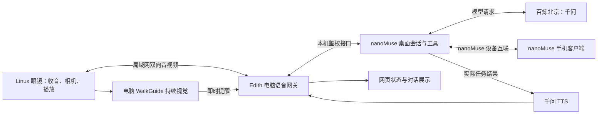

# Edith 接入 nanoMuse

## 目标与边界

眼镜使用现有 Pico Zero Linux、麦克风、喇叭和 IMX415。电脑运行 WalkGuide、语音网关和经过少量修改的 nanoMuse 桌面端。手机沿用 nanoMuse 官方客户端及其设备互联能力，不另写手机控制程序。

第一轮目标：说“嗨，Edith”，再说“在手机上打开某个 App”，或者“看看手机当前页面，读给我听”。电脑端 nanoMuse 使用千问理解指令，并使用它自身的设备列表、手机委派及屏幕工具。手机最终能做哪些操作，由现有 nanoMuse 客户端已取得的权限和实际设备状态决定。



唤醒、AEC、语音识别、8 秒退出和 WalkGuide 即时提醒继续在电脑网关运行。nanoMuse 模式不再调用旧的 Qwen Omni 对话逻辑，回答文字由 nanoMuse 产生，千问 TTS 只负责朗读。待唤醒音频不上传云端。明确要求查看眼前画面时，网关才将新鲜图像交给 nanoMuse；“手机页面”不会触发眼镜摄像头。

眼镜与电脑使用本地热点。nanoMuse 默认的设备互联仍经过它自己的 Cloud/Hub，不会因两台设备同处局域网而自动变成纯局域网服务；部署自己的 Relay 需要另外按上游自托管指南配置。使用自有百炼密钥也不会取消账号和 Hub。

## Windows 11 安装与构建

先完成 [4090 部署指南](部署指南-Windows11-RTX4090.md) 中现有 Edith 环境，再安装 Node.js 22 或更新版本、pnpm、Git。开发机已使用 Node 24 验证编译。

在 AIGlass 根目录运行：

```powershell
./scripts/setup-nanomuse.ps1
./scripts/start-nanomuse.ps1
```

需要已有代理时，给构建命令追加 `-Proxy http://127.0.0.1:代理端口`。下载会写入忽略的 `.tools/nanomuse`，不会把整个上游、依赖、模型或账号资料提交到 Git。也可以两条命令都指定相同的 `-Source` 路径。

构建固定为 nanoMuse `09850259cab00d27af83786f00faa09b5d8494bf`。接入脚本校验版本和源码锚点，遇到不认识的本地修改会停止，不覆盖用户修改。它只增加本机接口、将接口接入现有 TaskRunner，以及按需接收眼镜图像。升级上游需要重新审查、编译和测试，不能直接把固定版本改成 main。

启动脚本生成 `.local/nanomuse-token`，并使用独立配置目录 `.local/nanomuse-desktop`。不要把这个目录或令牌提交到 Git。此版本从源码运行，不能用未修改的官方安装包代替，也没有发布自己的安装包。电脑本身的鼠标键盘操作还需要上游 Hands runtime；第一轮手机任务使用 nanoMuse 的手机端。

## 账号与千问

1. 在打开的 nanoMuse 桌面窗口登录。手机安装 [nanoMuse 官方客户端](https://github.com/nano-muse/nanoMuse/releases)，登录同一账号，在其设备页确认电脑和手机互相在线。
2. 在 nanoMuse 设置中添加自己的“阿里云百炼”密钥，地区选择中国内地，北京接口为 `https://dashscope.aliyuncs.com/compatible-mode/v1`。当前 AIGlass 的 `.env` 不会自动写入 nanoMuse 的凭据库。
3. **明确选择千问作为聊天模型和看图/操作模型。** 上游该版本的百炼默认聊天模型是 DeepSeek，不能只添加百炼提供商就认为已经选中了千问。可从账号可用列表选择支持工具调用、并具备图像输入的千问模型。本机密钥已查询到 `qwen3.5-plus`、`qwen3-vl-plus` 和 `qwen3.8-27b`；查询列表不等于完成每个模型的工具联调。
4. 手机自己的 nanoMuse 也需要选择千问。委派给手机的是任务，手机会使用它自己的模型设置，电脑的选择不会自动覆盖手机。
5. 先在 nanoMuse 桌面原生聊天中验证能打开手机 App、读取页面，再将 AIGlass `.env` 设为 `AI_BACKEND=nanomuse`，重新启动 Edith 后端。

```dotenv
AI_BACKEND=nanomuse
NANOMUSE_BRIDGE_URL=http://127.0.0.1:18765
QWEN_TTS_MODEL=qwen3-tts-flash
QWEN_TTS_VOICE=Cherry
```

保留已有 `DASHSCOPE_API_KEY`，用于结果朗读；不要将 nanoMuse 登录令牌填进此字段。`AI_BACKEND=qwen` 保留原来的直连对话，方便分步联调；nanoMuse 模式失败时不会悄悄回退到另一套 AI 并假装完成手机任务。

## 语音与状态

- 普通回答、手机操作、看图进入 nanoMuse；明确的室内/室外模式口令继续走本地快速控制。
- 网页显示 nanoMuse 连接、Hub、手机在线数量，以及思考、执行、等待确认、取消中和状态待核实。任务工具进度进入事件区，最终答案进入对话区。
- nanoMuse 要求确认时，通过眼镜朗读原操作摘要，只接受“确认执行/允许执行/同意执行”或“取消执行/拒绝执行”。回答仅绑定当前未过期的 approval_id。其他话语不会被当成同意。
- 确认提示期间插话会停止提示并听取确认回答；普通任务期间插话会停止播报并请求取消对应任务。收到任务终态前不宣称手机已经停下。
- 危险视觉提醒优先，并请求取消当前 AI 任务。麦克风连接丢失也请求取消；语音进程退出后，本机接口的 30 秒租约继续兜底。
- 语音回答失败时保留 nanoMuse 实际文字结果，不重新执行已经完成的手机操作。
- 清空网页对话只清空展示，不删除 nanoMuse 的会话或取消正在执行的任务。网页仍不提供指令输入和批准按钮。

## 检查与验收

```powershell
python -m unittest discover -s tests -v
$env:NANOMUSE_CHECKOUT = (Resolve-Path .tools/nanomuse).Path
node --test tests/nanomuse-bridge.test.mjs
```

接入测试验证本地 HTTP 鉴权、重复请求、状态持久化、定向取消、确认匹配以及重启后结果恢复，使用模拟任务，不会操作真实手机。上游插件另跑 build、typecheck 和完整测试。TTS 已用现有百炼密钥完成真实短句合成，24 kHz WAV 可读。

真实验收顺序：nanoMuse 原生桌面能操作手机 → 切换后端 → 眼镜唤醒 → 打开指定 App → 读取实际页面 → 插话取消 → 语音确认 → 断网恢复。每一步同时检查桌面任务记录、手机真实界面、眼镜播报和网页状态，不能以模型说“完成”作为唯一证据。

截至本轮代码接入时，用户还未配置 nanoMuse 账号与手机绑定，因此**真实手机操作和眼镜到手机的完整闭环尚未验收**。IMX415 尚未到手，眼镜实拍也未验收。开发电脑验证不等于 4090 目标电脑已部署。

任务请求只发送一次；丢响应时查询原 turn 状态，不重放操作。如 `.local/nanomuse-turn.json` 记录的任务状态长期 unknown，请先在 nanoMuse 核实任务是否执行，再停止 Edith 后端并将该状态文件改名留存后重启。不要在未确认时清掉状态自动重跑。

参考：[nanoMuse 桌面结构](https://github.com/nano-muse/nanoMuse/blob/09850259cab00d27af83786f00faa09b5d8494bf/docs/desktop.md)、[设备互联协议](https://github.com/nano-muse/nanoMuse/blob/09850259cab00d27af83786f00faa09b5d8494bf/docs/hub.md)、[千问 TTS 官方接口](https://help.aliyun.com/en/model-studio/qwen-tts-api)。
